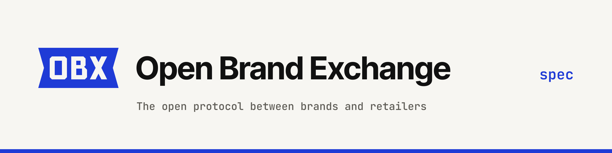
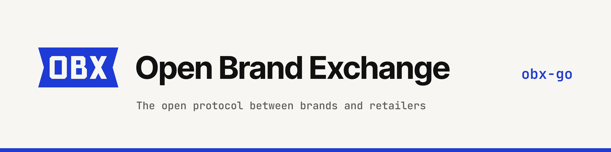
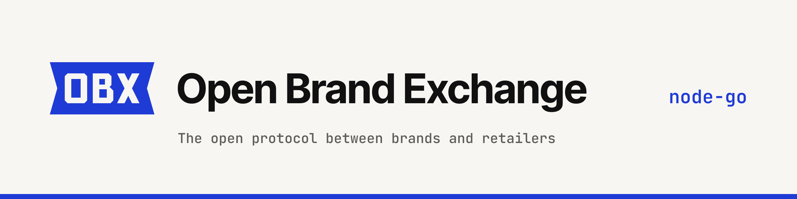

# Open Brand Exchange brand kit

The OBX mark is a woven garment label: a flat tag with V-notched ends, the letters **OBX** cut out of it.
Letters are knock-outs (holes), so whatever sits behind the label shows through. All text in these files
is converted to outlines, so nothing depends on installed fonts.

> Status: proposal. The site still uses the old mark, favicon and red accent. Nothing here is wired into the
> site until the colour direction is chosen.

## Colour

| Token | Hex | Use | Contrast (WCAG 2.x) |
|---|---|---|---|
| Blueprint | `#1f3bd6` | primary: mark, links, accents on light | 7.31:1 on paper `#f7f6f2`, 7.91:1 with white text on it (AA and AAA for body text) |
| Blueprint 300 | `#8fa2ff` | the same role on dark surfaces | 7.90:1 on ink `#111110` |
| Ink | `#111111` | text, mono mark | 17.46:1 on paper |
| Paper | `#f7f6f2` | background, reversed mono mark | |
| Night | `#111110` | dark background | |

Do not use `#1f3bd6` on dark backgrounds: it is only 2.39:1 on `#111110`. Use Blueprint 300 there.

**Monochrome fallback** (`*-mono-black`, `*-mono-white`): ink on paper or paper on ink. Use it where colour is
unavailable or unwanted (print, embossing, single-colour merch, partner pages with their own palette).

## Files

| File | What | Use |
|---|---|---|
| `logo/obx-mark.svg` (+ `-dark`, `-mono-black`, `-mono-white`) | the label mark, 56×28 | anywhere from 32 px wide |
| `logo/obx-logo.svg` (+ variants) | mark + "Open Brand Exchange" wordmark | headers, docs, slides, from 160 px wide |
| `logo/obx-icon.svg` (+ variants) | square icon cut: label with the X only, pixel-snapped | below 32 px: favicons, tabs, app icons |
| `favicon/favicon.svg` | icon, switches to Blueprint 300 in dark mode (`prefers-color-scheme`) | `<link rel="icon" type="image/svg+xml">` |
| `favicon/favicon-32.png` | 32×32 PNG | `<link rel="icon" sizes="32x32">` fallback |
| `favicon/apple-touch-icon-180.png` | 180×180, opaque paper tile | `<link rel="apple-touch-icon">` |
| `favicon/icon-512.png` | 512×512, opaque paper tile | web manifest / PWA |
| `avatar/obx-avatar.png` | 1000×1000, Blueprint field, paper label (safe in a round crop) | **GitHub org avatar** |
| `avatar/obx-avatar-mono.png` | 1000×1000 mono alternative | if mono is chosen |
| `banner/obx-banner-{light,dark}.svg` (+ `@2x.png`) | 1280×320 generic README banner | READMEs, posts |
| `banner/obx-banner-<repo>-{light,dark}.svg` (+ `@2x.png`) | per-repo README banner (PNG is 2560×640) | each repo README, see snippets below |
| `social/obx-social-<repo>.png` (+ `.svg`) | 1280×640 social preview | **GitHub repo social preview** |
| `src/` | masters (`mark-master.svg`, `icon-master.svg`), generator, repo descriptions | regenerate everything |

## Usage rules

**Clear space.** Keep free space around the mark of at least **half the label height** (14 units on the
56×28 master; 16 px around a 32 px-high mark). For the lockup, measure from the label.

**Minimum size.**
- Mark with OBX: 32 px wide on screen (40 px preferred), 12 mm in print.
- Lockup: 160 px wide.
- Below 32 px use the icon (`obx-icon`, favicon). It is drawn on the pixel grid for 16 and 32 px.

**Construction.** Label 56×28 with 4-unit notches; letters 16 units high (6-unit margin top and bottom), stems
3.5 units, X diagonals 3.58 units thick (perpendicular). In the lockup the wordmark (Inter Tight Bold) has
its cap height equal to the OBX letters, sits on the same baseline, and starts 0.42 label heights after the mark.

**Don'ts.**
- Don't put text, letters or another colour inside the label; the letters are holes, not paper-coloured fills.
- Don't round the corners, outline, add shadows/gradients or rotate the label.
- Don't stretch, condense or change the notch depth.
- Don't use the old red accent with the mark, or `#1f3bd6` on dark backgrounds (use Blueprint 300).
- Don't place the colour mark on busy photos or mid-tone backgrounds; use mono on a solid panel.
- Don't retype the wordmark in another font or set it in all-caps.
- Don't use the full OBX mark under 32 px; use the icon.

## Where each file goes (manual, GitHub web UI)

1. **Org avatar.** github.com/organizations/openbrandexchange/settings/profile → *Profile picture* →
   *Upload new picture* → `brand/avatar/obx-avatar.png` → keep the full square in the crop dialog → *Set new profile picture*.
2. **Social preview, per repo.** For each repo: github.com/openbrandexchange/`<repo>`/settings → *General* →
   *Social preview* → *Edit* → *Upload an image…*:

| Repo | File |
|---|---|
| `spec` | `brand/social/obx-social-spec.png` |
| `obx-go` | `brand/social/obx-social-obx-go.png` |
| `admin-ui` | `brand/social/obx-social-admin-ui.png` |
| `node-ts` | `brand/social/obx-social-node-ts.png` |
| `node-go` | `brand/social/obx-social-node-go.png` |
| `node-php` | `brand/social/obx-social-node-php.png` |
| `website` | `brand/social/obx-social-website.png` |

## README banner snippets

Paste at the top of each repo's README. The SVGs are served as `image/svg+xml` from raw.githubusercontent.com;
the `` PNG is the fallback.

### spec

```html
<picture>
  <source media="(prefers-color-scheme: dark)" srcset="https://raw.githubusercontent.com/openbrandexchange/website/main/brand/banner/obx-banner-spec-dark.svg">
  <source media="(prefers-color-scheme: light)" srcset="https://raw.githubusercontent.com/openbrandexchange/website/main/brand/banner/obx-banner-spec-light.svg">
  
</picture>
```

### obx-go

```html
<picture>
  <source media="(prefers-color-scheme: dark)" srcset="https://raw.githubusercontent.com/openbrandexchange/website/main/brand/banner/obx-banner-obx-go-dark.svg">
  <source media="(prefers-color-scheme: light)" srcset="https://raw.githubusercontent.com/openbrandexchange/website/main/brand/banner/obx-banner-obx-go-light.svg">
  
</picture>
```

### admin-ui

```html
<picture>
  <source media="(prefers-color-scheme: dark)" srcset="https://raw.githubusercontent.com/openbrandexchange/website/main/brand/banner/obx-banner-admin-ui-dark.svg">
  <source media="(prefers-color-scheme: light)" srcset="https://raw.githubusercontent.com/openbrandexchange/website/main/brand/banner/obx-banner-admin-ui-light.svg">
  
</picture>
```

### node-ts

```html
<picture>
  <source media="(prefers-color-scheme: dark)" srcset="https://raw.githubusercontent.com/openbrandexchange/website/main/brand/banner/obx-banner-node-ts-dark.svg">
  <source media="(prefers-color-scheme: light)" srcset="https://raw.githubusercontent.com/openbrandexchange/website/main/brand/banner/obx-banner-node-ts-light.svg">
  
</picture>
```

### node-go

```html
<picture>
  <source media="(prefers-color-scheme: dark)" srcset="https://raw.githubusercontent.com/openbrandexchange/website/main/brand/banner/obx-banner-node-go-dark.svg">
  <source media="(prefers-color-scheme: light)" srcset="https://raw.githubusercontent.com/openbrandexchange/website/main/brand/banner/obx-banner-node-go-light.svg">
  
</picture>
```

### node-php

```html
<picture>
  <source media="(prefers-color-scheme: dark)" srcset="https://raw.githubusercontent.com/openbrandexchange/website/main/brand/banner/obx-banner-node-php-dark.svg">
  <source media="(prefers-color-scheme: light)" srcset="https://raw.githubusercontent.com/openbrandexchange/website/main/brand/banner/obx-banner-node-php-light.svg">
  
</picture>
```

### website

```html
<picture>
  <source media="(prefers-color-scheme: dark)" srcset="https://raw.githubusercontent.com/openbrandexchange/website/main/brand/banner/obx-banner-website-dark.svg">
  <source media="(prefers-color-scheme: light)" srcset="https://raw.githubusercontent.com/openbrandexchange/website/main/brand/banner/obx-banner-website-light.svg">
  
</picture>
```

## Regenerating

```sh
# from the website repo root, after npm ci (fonts come from @fontsource-variable)
python3 brand/src/build.py brand/src/mark-master.svg brand/src/icon-master.svg brand
```

Needs python3 with `fonttools` and `brotli`, `hb-shape` (harfbuzz) and `rsvg-convert` (librsvg). To change a
repo description, edit `src/repos.json`. To change colours, edit the constants at the top of `src/build.py`.
